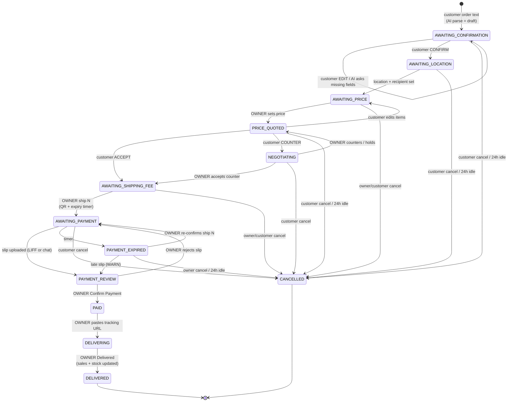

# ARCHITECTURE_AND_DB.md — System Architecture, Database & State Machine

The SQL in §2 is copied verbatim into `supabase/migrations/0001_init.sql`. **The migration file is the source of truth**; if you change the schema, change the migration and update this doc in the same PR.

---

## 1. System Architecture

```mermaid
flowchart LR
  subgraph Customer["Customer (B2C / B2B)"]
    LC[LINE Chat]
    LIFF[LIFF Order Room<br/>Next.js /liff]
  end

  subgraph Owner["Shop Owner"]
    OL[Owner LINE account]
    DASH[Dashboard PWA<br/>Next.js /dashboard]
  end

  subgraph CF["Cloudflare Workers (Free)"]
    WH[/webhook<br/>signature + dedupe/]
    API[REST API<br/>Hono]
    CRON[[Cron every 1 min<br/>timers · quota · cleanup]]
    QG[Quota Guard<br/>sendPushGuarded]
    PII[PII strip / restore]
  end

  subgraph SB["Supabase (Free)"]
    PG[(Postgres)]
    RT((Realtime))
    ST[(Storage<br/>slips · supplier-bills)]
    AUTH[Auth<br/>owner only]
  end

  GEM[Gemini Flash API<br/>Structured Output]
  LINEAPI[LINE Messaging API]
  MAP[Longdo Map / OSM]
  WP[Web Push service<br/>browser vendor]

  LC -- events --> LINEAPI -- webhook --> WH
  OL -- commands --> LINEAPI
  WH --> API
  API -- reply (free) --> LINEAPI
  QG -- push (budgeted) --> LINEAPI
  API --> QG
  API <--> PG
  API --> ST
  API --> PII --> GEM
  API --> MAP
  LIFF -- LIFF ID token --> API
  LIFF <-. broadcast ping .- RT
  DASH -- Supabase JWT --> API
  DASH <-. postgres_changes .- RT
  DASH --> AUTH
  PG --> RT
  CRON --> API
  API -- VAPID --> WP --> DASH
```

### 1.1 Request paths
| Path | Flow | LINE quota |
|---|---|---|
| Customer chat text | LINE → `/webhook` → order parser (Gemini via PII layer) → reply card | 0 (reply) |
| Customer LIFF action | LIFF → `POST /api/liff/...` (LIFF ID token) → DB → Realtime ping | 0 |
| Owner LINE command | LINE → `/webhook` → deterministic command parser → DB → reply to owner | 0 (reply) |
| Owner dashboard action | Dashboard → `POST /api/owner/...` (Supabase JWT) → DB | 0 |
| Customer update while LIFF closed | Quota Guard decides push or defer | 0–1 |
| Owner alert | Web Push + Realtime | 0 |

### 1.2 Why these hosts
- **Cloudflare Workers Free:** no cold-start sleep (reply token must be used quickly), Cron Triggers included, 100k requests/day is far above our load (incl. LIFF heartbeats). Requires `nodejs_compat` flag. Koyeb is the fallback if a needed Node library will not run on Workers.
- **Next.js on Vercel Hobby or Cloudflare Pages:** static + client-side app; all privileged logic lives in the Worker.
- **Supabase Free:** 500 MB DB, 1 GB storage, Realtime, Auth. Pauses after ~7 days of inactivity (risk D5).

### 1.3 Realtime design
- **Owner dashboard:** `postgres_changes` on `orders`, `negotiations`, `payments`, `quota_logs`, protected by RLS (`is_owner()`).
- **Customer LIFF:** customers have no Supabase account. The Worker sends a **Broadcast** on channel `order:{order_id}:{realtime_token}` containing only `{ "type": "order_updated", "version": n }`. LIFF then refetches through the API (which checks the LIFF ID token). The channel name contains a 128-bit random token and carries no PII.
- **Presence for push decisions:** LIFF calls `POST /api/liff/orders/:id/heartbeat` every 30 s while visible → `orders.customer_last_seen_at`. "Present" = seen in the last 60 s.

---

## 2. PostgreSQL Schema (SQL DDL)

Conventions: UUID PKs, `timestamptz` in UTC, money as `bigint` satang, quantities as `numeric(10,3)`.

```sql
-- =====================================================================
-- 0001_init.sql — Da Tawan Seafood (Team HighLow)
-- =====================================================================
create extension if not exists pgcrypto;

-- ---------- Enums ----------
create type user_type as enum ('B2C', 'B2B');

create type order_status as enum (
  'AWAITING_CONFIRMATION',
  'AWAITING_LOCATION',
  'AWAITING_PRICE',
  'PRICE_QUOTED',
  'NEGOTIATING',
  'AWAITING_SHIPPING_FEE',
  'AWAITING_PAYMENT',
  'PAYMENT_EXPIRED',
  'PAYMENT_REVIEW',
  'PAID',
  'DELIVERING',
  'DELIVERED',
  'CANCELLED'
);

create type prep_type as enum ('live', 'chilled', 'frozen', 'cooked', 'any');
create type slip_check_result as enum ('PENDING', 'PASS', 'WARN', 'FAIL');
create type event_actor as enum ('owner', 'customer', 'system', 'ai');
create type negotiation_action as enum ('quote', 'counter', 'accept', 'hold', 'reject');
create type stock_reason as enum ('stock_in', 'sale', 'waste', 'adjust');
create type quota_mode as enum ('NORMAL', 'WARNING', 'QUOTA_SAVER');

-- ---------- Helpers ----------
create or replace function is_owner() returns boolean
language sql stable as $$
  select coalesce((auth.jwt() -> 'app_metadata' ->> 'role') = 'owner', false)
$$;

create or replace function set_updated_at() returns trigger
language plpgsql as $$
begin
  new.updated_at = now();
  return new;
end $$;

-- ---------- users ----------
create table users (
  id                      uuid primary key default gen_random_uuid(),
  line_user_id            text not null unique,           -- PII: never sent to Gemini
  display_name            text,                           -- LINE display name (PII)
  full_name               text,                           -- PII
  phone                   text,                           -- PII
  user_type               user_type not null default 'B2C',
  business_name           text,                           -- B2B restaurant name
  default_delivery_window text,                           -- B2B e.g. '06:00-08:00'
  pdpa_consent_at         timestamptz,
  active_order_id         uuid,                           -- FK added after orders
  is_active               boolean not null default true,  -- false after unfollow
  created_at              timestamptz not null default now(),
  updated_at              timestamptz not null default now(),
  constraint b2b_needs_business check (user_type = 'B2C' or business_name is not null)
);

-- ---------- addresses ----------
create table addresses (
  id               uuid primary key default gen_random_uuid(),
  user_id          uuid not null references users(id) on delete cascade,
  label            text,                                  -- 'บ้าน', 'ร้าน'
  recipient_name   text,                                  -- PII
  recipient_phone  text,                                  -- PII
  address_text     text,                                  -- PII
  lat              numeric(9,6),
  lng              numeric(9,6),
  source           text not null check (source in ('line_pin', 'typed', 'maps_link', 'saved')),
  is_default       boolean not null default false,
  created_at       timestamptz not null default now()
);
create index addresses_user_idx on addresses(user_id);

-- ---------- products ----------
create table products (
  id          uuid primary key default gen_random_uuid(),
  name_th     text not null,
  aliases     text[] not null default '{}',               -- slang/spellings for the parser
  unit        text not null check (unit in ('kg', 'piece', 'box', 'tray', 'set')),
  prep_types  prep_type[] not null default '{any}',
  is_active   boolean not null default true,
  created_at  timestamptz not null default now(),
  updated_at  timestamptz not null default now()
);

-- ---------- orders ----------
create table orders (
  id                     uuid primary key default gen_random_uuid(),
  order_no               bigint generated always as identity unique,
  code                   text not null,                   -- short code e.g. 'A12' used in owner commands
  user_id                uuid not null references users(id),
  address_id             uuid references addresses(id),
  recipient_name         text,                            -- snapshot (PII)
  recipient_phone        text,                            -- snapshot (PII)
  status                 order_status not null default 'AWAITING_CONFIRMATION',
  channel                text not null default 'chat' check (channel in ('chat', 'liff')),
  source_order_id        uuid references orders(id),      -- set for B2B reorders
  requested_delivery_at  timestamptz,
  raw_order_text         text,                            -- original chat (PII possible; stored, never sent raw)
  ai_parse               jsonb,                           -- Gemini draft (OrderParseResult)
  needs_owner_review     boolean not null default false,  -- AI failed or low confidence
  product_price_satang   bigint check (product_price_satang >= 0),
  price_note             text,                            -- weight variance note
  shipping_fee_satang    bigint check (shipping_fee_satang >= 0),
  total_satang           bigint generated always as (product_price_satang + shipping_fee_satang) stored,
  quoted_at              timestamptz,
  payment_expires_at     timestamptz,
  paid_at                timestamptz,
  paid_confirmed_by      uuid references auth.users(id),  -- owner who confirmed
  tracking_url           text,
  dispatched_at          timestamptz,
  delivered_at           timestamptz,
  cancelled_at           timestamptz,
  cancel_reason          text,
  owner_reminded_at      timestamptz,
  customer_last_seen_at  timestamptz,                     -- LIFF heartbeat (presence)
  push_count             int not null default 0,
  realtime_token         text not null default encode(gen_random_bytes(16), 'hex'),
  version                int not null default 1,          -- bumped on every change
  created_at             timestamptz not null default now(),
  updated_at             timestamptz not null default now(),
  constraint paid_needs_owner check (status <> 'PAID' or paid_confirmed_by is not null)
);
create unique index orders_open_code_uidx on orders(code)
  where status not in ('DELIVERED', 'CANCELLED');
create index orders_user_status_idx on orders(user_id, status);
create index orders_status_idx on orders(status);

alter table users
  add constraint users_active_order_fk
  foreign key (active_order_id) references orders(id) on delete set null;

-- ---------- order_items ----------
create table order_items (
  id                 uuid primary key default gen_random_uuid(),
  order_id           uuid not null references orders(id) on delete cascade,
  product_id         uuid references products(id),        -- null = unknown, owner resolves
  raw_text           text not null,                       -- span from the chat
  qty                numeric(10,3) not null check (qty > 0),
  unit               text not null,
  prep_type          prep_type not null default 'any',
  actual_qty         numeric(10,3),                       -- weighed amount (variance)
  cost_satang        bigint,                              -- snapshot of cost at quote time
  unit_price_satang  bigint,                              -- optional per-item breakdown
  note               text,
  sort               int not null default 0
);
create index order_items_order_idx on order_items(order_id);

-- ---------- negotiations (includes the owner's quotes) ----------
create table negotiations (
  id             uuid primary key default gen_random_uuid(),
  order_id       uuid not null references orders(id) on delete cascade,
  round          int not null,
  actor          event_actor not null check (actor in ('owner', 'customer')),
  action         negotiation_action not null,
  amount_satang  bigint check (amount_satang >= 0),
  margin_satang  bigint,                                  -- computed by code at that moment
  message        text,
  created_at     timestamptz not null default now(),
  unique (order_id, round)
);

-- ---------- payments (slips) ----------
create table payments (
  id               uuid primary key default gen_random_uuid(),
  order_id         uuid not null references orders(id) on delete cascade,
  slip_path        text,                                  -- storage: slips/<order_id>/<uuid>.jpg
  ai_extract       jsonb,                                 -- SlipReadResult (draft)
  amount_satang    bigint,
  slip_time        timestamptz,
  receiver_text    text,
  reference_no     text,
  check_result     slip_check_result not null default 'PENDING',
  check_details    jsonb,                                 -- per-rule results
  confirmed_by     uuid references auth.users(id),
  confirmed_at     timestamptz,
  override_reason  text,                                  -- required if confirmed on WARN/FAIL
  created_at       timestamptz not null default now()
);
create unique index payments_reference_uidx on payments(reference_no) where reference_no is not null;

-- ---------- supplier bills ----------
create table supplier_bills (
  id             uuid primary key default gen_random_uuid(),
  image_path     text not null,                           -- storage: supplier-bills/<uuid>.jpg
  ai_extract     jsonb,                                   -- SupplierBillResult (draft)
  status         text not null default 'draft' check (status in ('draft', 'saved', 'discarded')),
  supplier_name  text,
  bill_date      date,
  total_satang   bigint,
  saved_by       uuid references auth.users(id),
  saved_at       timestamptz,
  created_at     timestamptz not null default now()
);

-- ---------- stock_logs (append-only ledger) ----------
create table stock_logs (
  id                uuid primary key default gen_random_uuid(),
  product_id        uuid not null references products(id),
  reason            stock_reason not null,
  qty_delta         numeric(10,3) not null,               -- + in, - out
  unit_cost_satang  bigint,                               -- for stock_in
  order_id          uuid references orders(id),
  supplier_bill_id  uuid references supplier_bills(id),
  note              text,
  created_by        uuid references auth.users(id),       -- owner (directly or via Delivered tap)
  created_at        timestamptz not null default now()
);
create index stock_logs_product_idx on stock_logs(product_id, created_at desc);

create view product_stock as
  select p.id as product_id, p.name_th, p.unit,
         coalesce(sum(s.qty_delta), 0) as on_hand
  from products p
  left join stock_logs s on s.product_id = p.id
  group by p.id;

-- ---------- price_history ----------
create table price_history (
  id                 uuid primary key default gen_random_uuid(),
  product_id         uuid not null references products(id),
  kind               text not null check (kind in ('cost', 'sell')),
  unit_price_satang  bigint not null,
  source             text not null check (source in ('supplier_bill', 'order', 'manual')),
  user_id            uuid references users(id),           -- buyer, for B2B anchoring
  order_id           uuid references orders(id),
  supplier_bill_id   uuid references supplier_bills(id),
  recorded_at        timestamptz not null default now()
);
create index price_history_product_idx on price_history(product_id, kind, recorded_at desc);
create index price_history_user_idx on price_history(user_id, product_id, recorded_at desc);

-- ---------- quota_logs ----------
create table quota_logs (
  id           uuid primary key default gen_random_uuid(),
  month        date not null,                             -- first day of month (Asia/Bangkok)
  limit_count  int not null,
  total_usage  int not null,                              -- from LINE API
  local_count  int not null,                              -- our own counter
  mode         quota_mode not null,
  checked_at   timestamptz not null default now()
);
create index quota_logs_month_idx on quota_logs(month, checked_at desc);

-- ---------- order_events (audit trail) ----------
create table order_events (
  id           uuid primary key default gen_random_uuid(),
  order_id     uuid not null references orders(id) on delete cascade,
  actor        event_actor not null,
  event        text not null,                             -- e.g. 'PRICE_SET', 'PUSH_SENT', 'PUSH_DEFERRED'
  from_status  order_status,
  to_status    order_status,
  payload      jsonb,
  created_at   timestamptz not null default now()
);
create index order_events_order_idx on order_events(order_id, created_at);

-- ---------- infra tables ----------
create table line_events (
  webhook_event_id  text primary key,
  received_at       timestamptz not null default now()
);

create table push_subscriptions (
  id          uuid primary key default gen_random_uuid(),
  owner_id    uuid not null references auth.users(id) on delete cascade,
  endpoint    text not null unique,
  p256dh      text not null,
  auth        text not null,
  user_agent  text,
  created_at  timestamptz not null default now()
);

create table settings (
  key         text primary key,                           -- 'default_markup', 'payment_expiry_minutes', ...
  value       jsonb not null,
  updated_at  timestamptz not null default now()
);

-- ---------- Triggers ----------
create trigger users_updated_at before update on users
  for each row execute function set_updated_at();
create trigger products_updated_at before update on products
  for each row execute function set_updated_at();
create trigger orders_updated_at before update on orders
  for each row execute function set_updated_at();

-- Bump version so LIFF/dashboard can detect stale state
create or replace function bump_order_version() returns trigger
language plpgsql as $$
begin
  new.version = old.version + 1;
  return new;
end $$;
create trigger orders_bump_version before update on orders
  for each row execute function bump_order_version();

-- Defence in depth: DELIVERED requires PAID history and a dispatch
create or replace function guard_order_status() returns trigger
language plpgsql as $$
begin
  if new.status = 'DELIVERED' and (new.paid_confirmed_by is null or new.dispatched_at is null) then
    raise exception 'DELIVERED requires owner-confirmed payment and dispatch';
  end if;
  if new.status = 'DELIVERING' and new.paid_confirmed_by is null then
    raise exception 'DELIVERING requires owner-confirmed payment';
  end if;
  return new;
end $$;
create trigger orders_guard_status before update on orders
  for each row execute function guard_order_status();

-- ---------- Row Level Security ----------
alter table users              enable row level security;
alter table addresses          enable row level security;
alter table products           enable row level security;
alter table orders             enable row level security;
alter table order_items        enable row level security;
alter table negotiations       enable row level security;
alter table payments           enable row level security;
alter table supplier_bills     enable row level security;
alter table stock_logs         enable row level security;
alter table price_history      enable row level security;
alter table quota_logs         enable row level security;
alter table order_events       enable row level security;
alter table line_events        enable row level security;
alter table push_subscriptions enable row level security;
alter table settings           enable row level security;

-- Owner: full access from the dashboard. Customers never hit Postgres directly:
-- the Worker uses the service-role key (bypasses RLS) after verifying the LIFF ID token.
create policy owner_all on users              for all using (is_owner()) with check (is_owner());
create policy owner_all on addresses          for all using (is_owner()) with check (is_owner());
create policy owner_all on products           for all using (is_owner()) with check (is_owner());
create policy owner_all on orders             for all using (is_owner()) with check (is_owner());
create policy owner_all on order_items        for all using (is_owner()) with check (is_owner());
create policy owner_all on negotiations       for all using (is_owner()) with check (is_owner());
create policy owner_all on payments           for all using (is_owner()) with check (is_owner());
create policy owner_all on supplier_bills     for all using (is_owner()) with check (is_owner());
create policy owner_all on stock_logs         for all using (is_owner()) with check (is_owner());
create policy owner_all on price_history      for all using (is_owner()) with check (is_owner());
create policy owner_read on quota_logs        for select using (is_owner());
create policy owner_read on order_events      for select using (is_owner());
create policy owner_all on settings           for all using (is_owner()) with check (is_owner());
create policy owner_own_subs on push_subscriptions
  for all using (owner_id = auth.uid()) with check (owner_id = auth.uid());
-- line_events: no policy = service role only.

-- Audit log is append-only even for the owner
revoke update, delete on order_events from authenticated;
revoke update, delete on stock_logs from authenticated;

-- ---------- Realtime ----------
alter publication supabase_realtime add table orders, negotiations, payments, quota_logs;

-- ---------- Storage ----------
insert into storage.buckets (id, name, public, file_size_limit, allowed_mime_types)
values
  ('slips',          'slips',          false, 1048576, array['image/jpeg', 'image/png', 'image/webp']),
  ('supplier-bills', 'supplier-bills', false, 1048576, array['image/jpeg', 'image/png', 'image/webp'])
on conflict (id) do nothing;

create policy owner_read_images on storage.objects
  for select using (bucket_id in ('slips', 'supplier-bills') and is_owner());
create policy owner_upload_bills on storage.objects
  for insert with check (bucket_id = 'supplier-bills' and is_owner());
-- Customer slip uploads: the Worker creates a signed upload URL (service role) after
-- verifying the LIFF ID token and order ownership. Chat images are downloaded from
-- LINE by the Worker and uploaded with the service role.
```

### 2.1 Notes on the schema
- **Owner account:** create one Supabase Auth user and set `app_metadata.role = 'owner'` (Dashboard → Authentication → user → edit raw app metadata, or `auth.admin.updateUserById`).
- **`paid_needs_owner` constraint + `guard_order_status` trigger** make it impossible, even by a bug, to mark an order `PAID`/`DELIVERING`/`DELIVERED` without an owner ID. The Worker sets `paid_confirmed_by` only from an owner-authenticated request or a message from `LINE_OWNER_USER_ID`.
- **Order code:** the Worker generates `code` as `A` + (`order_no` mod 1000), skipping codes still open; unique among open orders only, so codes stay short for LINE commands.
- **Stock:** `product_stock` view sums the ledger. On `DELIVERED`, the Worker writes one `sale` row per item with `qty_delta = -(actual_qty ?? qty)` in the same transaction as the status change, `created_by` = owner.
- **Retention:** daily cron lists objects older than `STORAGE_RETENTION_DAYS` (60) via the Storage API and deletes them; DB rows keep `slip_path` but the UI shows "รูปถูกลบตามนโยบาย 60 วัน". Use the Storage API, not `DELETE FROM storage.objects`, so files are actually removed.
- **Capacity check:** ~450 orders/month × ~5 rows each ≈ tiny; images compressed to ≤ 300 KB × ~600/month ≈ 180 MB rolling with 60-day cleanup → under 1 GB.

---

## 3. Today's Sales Summary (query)

```sql
-- Dashboard home. "Today" in Asia/Bangkok.
select
  count(*)                                         as orders_delivered,
  coalesce(sum(o.product_price_satang), 0)         as product_revenue_satang,
  coalesce(sum(o.shipping_fee_satang), 0)          as shipping_collected_satang,
  coalesce(sum(o.product_price_satang), 0)
    - coalesce(sum(c.cost), 0)                     as gross_margin_satang
from orders o
left join lateral (
  select sum(oi.cost_satang) as cost from order_items oi where oi.order_id = o.id
) c on true
where o.status = 'DELIVERED'
  and o.delivered_at >= date_trunc('day', now() at time zone 'Asia/Bangkok') at time zone 'Asia/Bangkok';
```

---

## 4. Order State Machine

Implemented once in `packages/shared/src/state/orderMachine.ts` and used by both Worker and dashboard (for which buttons to show).



### 4.1 Transition table (who may fire what)

| From | Event | Actor | To | Side effects |
|---|---|---|---|---|
| AWAITING_CONFIRMATION | `CUSTOMER_CONFIRM` | customer | AWAITING_LOCATION | set `active_order_id` |
| AWAITING_LOCATION | `LOCATION_SET` | customer | AWAITING_PRICE | Web Push owner; start 15-min timer |
| AWAITING_PRICE | `OWNER_SET_PRICE` | **owner** | PRICE_QUOTED | `negotiations` round(quote); `quoted_at`; guarded push P1 |
| PRICE_QUOTED | `CUSTOMER_ACCEPT` | customer | AWAITING_SHIPPING_FEE | Web Push owner |
| PRICE_QUOTED | `CUSTOMER_COUNTER(amount)` | customer | NEGOTIATING | margin computed; Web Push owner |
| NEGOTIATING | `OWNER_ACCEPT` | **owner** | AWAITING_SHIPPING_FEE | price := counter |
| NEGOTIATING | `OWNER_COUNTER(amount)` / `OWNER_HOLD` | **owner** | PRICE_QUOTED | guarded push P2 |
| AWAITING_SHIPPING_FEE | `OWNER_SET_SHIPPING(fee)` | **owner** | AWAITING_PAYMENT | QR payload; `payment_expires_at`; Lalamove copy card |
| AWAITING_PAYMENT | `SLIP_UPLOADED` | customer | PAYMENT_REVIEW | Gemini read → code check → Web Push owner |
| AWAITING_PAYMENT | `PAYMENT_TIMEOUT` | system | PAYMENT_EXPIRED | LIFF shows locked |
| PAYMENT_EXPIRED | `OWNER_SET_SHIPPING(fee)` | **owner** | AWAITING_PAYMENT | new QR + timer |
| PAYMENT_REVIEW | `OWNER_CONFIRM_PAYMENT` | **owner** | PAID | `paid_confirmed_by`, `paid_at` |
| PAYMENT_REVIEW | `OWNER_REJECT_SLIP` | **owner** | AWAITING_PAYMENT | reply/LIFF reason |
| PAID | `OWNER_DISPATCH(url)` | **owner** | DELIVERING | guarded push P1 |
| DELIVERING | `OWNER_DELIVERED` | **owner** | DELIVERED | stock `sale` rows; `price_history` sell rows; clear `active_order_id` |

**Rule:** no event with actor `system` or `ai` targets `PAID`, `DELIVERING`, `DELIVERED`, or writes `stock_logs`. A unit test enumerates the table to prove it.
